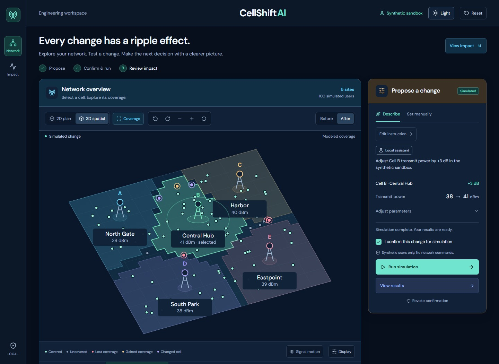
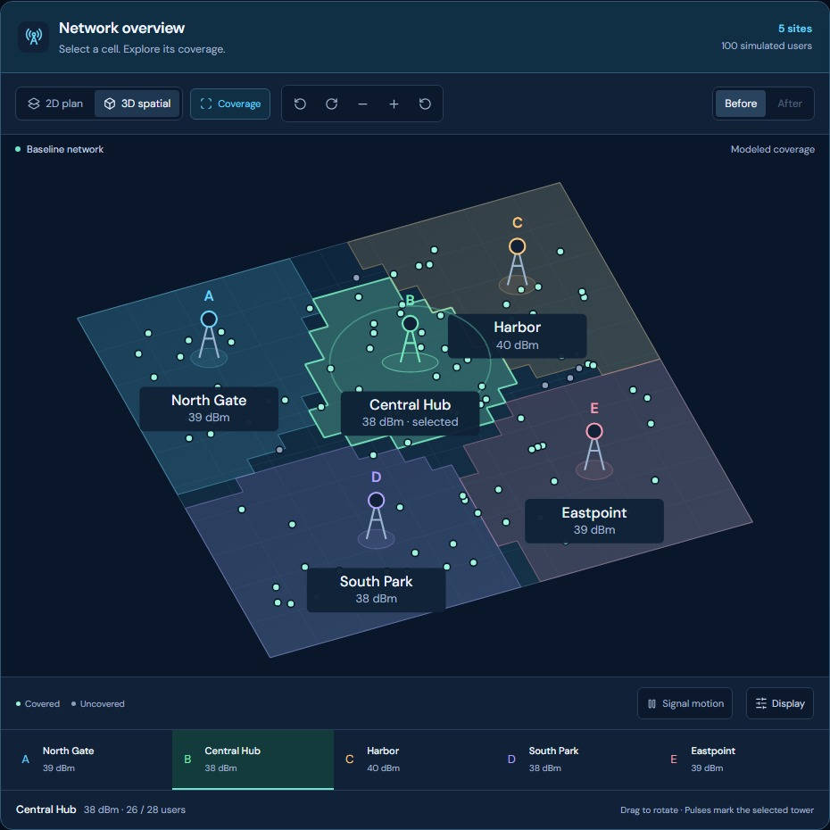
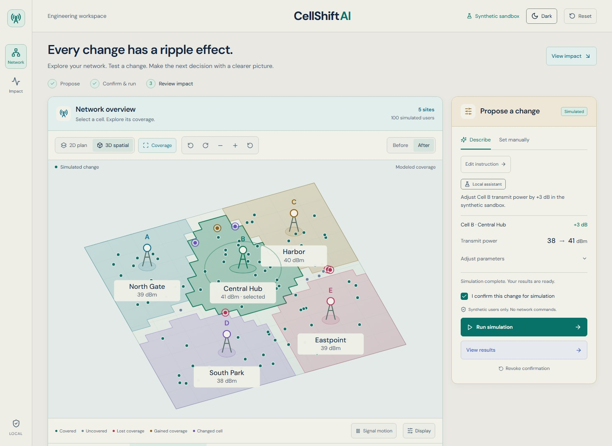
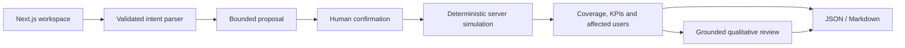

<div align="center">


# CellShiftAI

**See the trade-offs before you change the network.**

A cellular-network pre-change review sandbox. Describe a power adjustment, confirm it, and inspect reproducible before-and-after evidence.

[Quick start](#run-locally) · [Screenshots](docs/GALLERY.md) · [Architecture](docs/ARCHITECTURE.md) · [Contributing](CONTRIBUTING.md)

[](https://github.com/NafisAfzal/CellShiftAI/actions/workflows/ci.yml)


</div>



> Five fictional sites. One hundred seeded simulated users. No live network connection. The calculations are illustrative proxies, not validated RF predictions.

## What it does

A small power change can improve one area while creating interference or moving load elsewhere. CellShiftAI makes that trade-off visible and keeps the proposed action, computed evidence, and review together.

| Step | In the workspace |
| --- | --- |
| Inspect | Explore coverage, serving sites and simulated users in a proportional 2D plan or a rotatable 3D schematic. |
| Propose | Describe a change in plain language or set the site and power delta manually. |
| Confirm | Review the bounded proposal and explicitly approve it for simulation. |
| Compare | Switch between before/after coverage, inspect KPI changes and trace affected users. |
| Review | Generate a grounded engineering review with validation and rollback checks. |
| Export | Download the current evidence as JSON or a Markdown report. |

AI handles intent and qualitative review. **The deterministic TypeScript engine computes every numerical KPI on the server.** The app works without an AI key; local and fallback responses are labeled honestly.

<table>
  <tr>
    <td width="50%"></td>
    <td width="50%"></td>
  </tr>
  <tr><td>Interactive spatial view</td><td>Comfortable light theme</td></tr>
</table>

## Run locally

Use **Node.js 24** and npm. Dependencies require internet for installation. The local assistant needs no account or provider key.

```sh
git clone https://github.com/NafisAfzal/CellShiftAI.git
cd CellShiftAI
npm ci
npm run dev
```

Open **http://127.0.0.1:3000**. The repository is private; cloning requires an accepted invitation or owner access.

No environment file is required for the default local mode. For explicit configuration, copy `.env.example` to `.env.local` (`Copy-Item .env.example .env.local` in PowerShell, or `cp .env.example .env.local` in a POSIX shell). Keep `AI_MODE=mock` to avoid provider requests.

To try the workflow, enter **“Increase Cell B power by 3 dB”**, choose **Interpret change**, confirm the proposal, and choose **Run simulation**. Results appear in **Change impact**. Use **Generate review**, then **JSON data** or **Markdown report** to export.

For a different port: `npm run dev -- --port 3010`. See [provider setup](docs/AI_PROVIDER_SETUP.md) for optional OpenRouter or Gemini configuration and [troubleshooting](TROUBLESHOOTING.md) for common setup issues.

## How it is built



| Part | Technology and responsibility |
| --- | --- |
| Workspace | Next.js App Router, React, TypeScript and semantic CSS theme tokens |
| Visualization | SVG 2D/3D projection, server-sampled coverage and keyboard-accessible selections |
| Simulation | Seeded TypeScript model; identical inputs produce identical results |
| AI | Server-only OpenRouter or official Google GenAI SDK, Zod-validated output, local fallback |
| Persistence | Optional Firebase anonymous authentication and owner-scoped Firestore metadata |
| Verification | Node test runner, ESLint, TypeScript, Playwright, npm audit and Gitleaks |

```text
app/          Workspace, themes and server API routes
components/   Topology, proposal controls, impact and review panels
lib/          Simulation, validation, providers, projection and export logic
tests/        Deterministic behavior and regression tests
scripts/      Browser checks, documentation captures and publication guards
contracts/    Example data and JSON schemas
firebase/     Optional Firestore access rules
docs/         Architecture, screenshots, API, design and verification notes
.github/      CI, dependency updates, templates and ownership policy
```

Read the [architecture](docs/ARCHITECTURE.md), [simulation model](docs/04-simulation-spec-v2.md), [API contracts](docs/06-api-contracts-and-data.md), and [design rationale](docs/DESIGN.md) for implementation details and limits.

## Checks

```sh
npm test
npm run typecheck
npm run lint
npm run build
npm run security:check
npm audit --audit-level=moderate
```

With the app running in another terminal:

```sh
npx playwright install chromium
npm run test:ui
npm run test:topology
```

Browser checks cover approval, theme persistence, real simulation responses, exports, responsive layouts and topology framing. Expanded feature checks run real local parsing/review in Chromium, Firefox and WebKit, including failures and retries. **CI does not use provider secrets or make paid AI calls.** See [testing](docs/TESTING.md) for scope, alternate ports and exact commands.

## Team and branches

| Person | GitHub | Working branch |
| --- | --- | --- |
| Nafis — owner and final reviewer | [NafisAfzal](https://github.com/NafisAfzal) | `nafis` |
| Jabir | [tasnimjabir](https://github.com/tasnimjabir) | `jabir` |
| Junaid | [Junaid-redart](https://github.com/Junaid-redart) | `junaid` |
| Sami | [mostahidhossainsami](https://github.com/mostahidhossainsami) | `sami` |

`main` is the owner-controlled baseline. Nafis works on `nafis`, pushes that branch, and brings checked changes into `main` through a pull request. The local push hook blocks direct pushes to `main`. Repository administration belongs to **NafisAfzal**.

**Current access:** the private repository is owner-only. Pending teammate write invitations were withdrawn because the current GitHub plan cannot restrict private branches. The named teammate branches remain reserved, but teammates cannot push to them yet. Once a supported plan is available, the [protection setup](scripts/protect-main.ps1) can enforce owner-only `main` updates and then restore the requested invitations. It verifies protection before inviting anyone. See [repository governance](docs/REPOSITORY.md). The repository stays private unless Nafis changes its visibility.

## Security and limits

Provider credentials belong only in ignored server configuration. Never put an AI provider key in a `NEXT_PUBLIC_*` variable, issue, screenshot, export or commit. Firebase's optional browser configuration is a separate, intentionally public SDK configuration; access is controlled by authentication and Firestore rules.

The local API has bounded input validation, request-size checks and demo rate limits. It does **not** provide production authentication, distributed quotas, a validated propagation model or operator integration. Publishing this source is a separate decision from exposing a running server to the internet.

See [SECURITY.md](SECURITY.md), the [threat model](docs/05-security-threat-model.md), and the [public-release checklist](docs/PUBLIC_RELEASE.md).

This repository currently has no open-source license. Source availability, if made public later, does not itself grant permission to reuse it. Third-party dependencies retain their own licenses.
