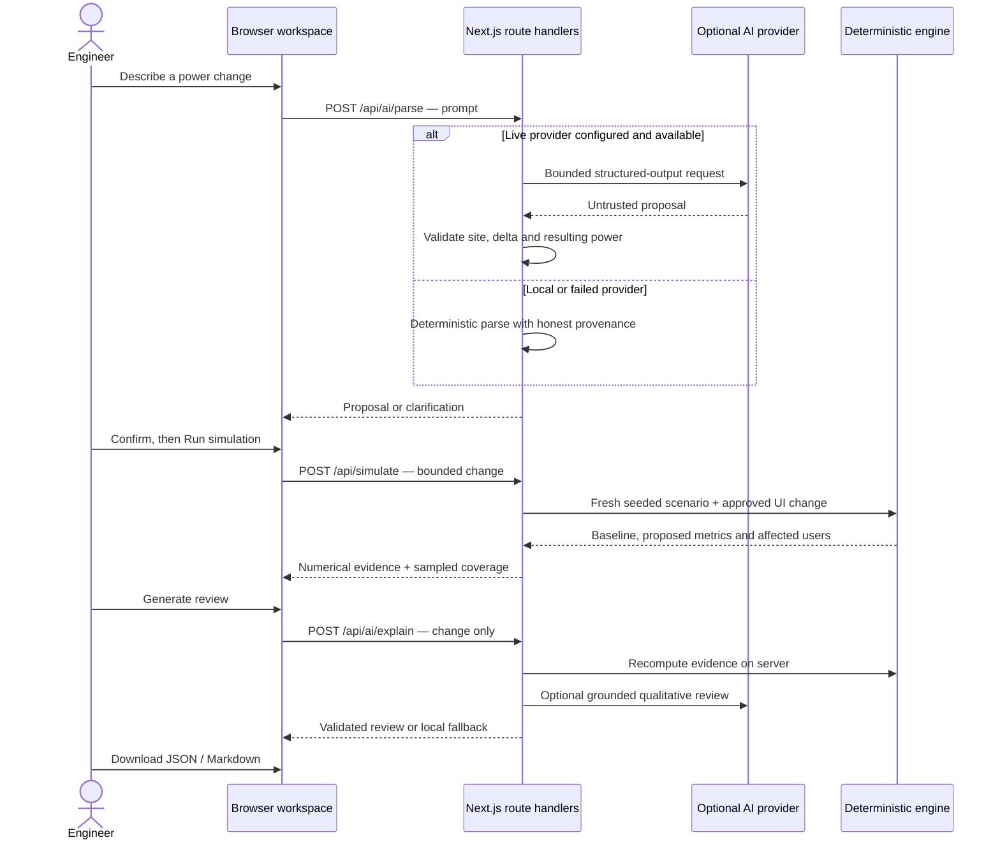

# Architecture

CellShiftAI is a single Next.js App Router application. The browser manages the review workflow and visualization; route handlers validate requests and compute evidence. There is no separate Python service, RF backend, database requirement or network-control integration.

## Request flow

Human confirmation is a **browser workflow requirement**. The localhost API is not authenticated and does not enforce a server-side approval identity. Do not use it as an authorization system.

## Main modules

| Module | Responsibility |
| --- | --- |
| `app/page.tsx` | Draft, approval, requests, results, user selection and reset state |
| `components/ProposalControlPanel.tsx` | Describe/manual modes, bounds, confirmation and run readiness |
| `components/TopologyCanvas.tsx` | SVG plot, camera, selectors and user evidence highlighting |
| `lib/topology-view.ts` | Pure projection and geometry-aware stable framing |
| `lib/coverage-field.ts` | Server sampling of the synthetic field through the engine |
| `lib/coverage-geometry.ts` | Geometry for coverage fills and boundary paths |
| `lib/simulation.ts` | Seeded scenario, validation, proxy KPIs and rule-based review priority |
| `lib/ai.ts` | Parsing, output validation and grounded review construction |
| `lib/ai-provider.ts` | Server credential use, provider selection and bounded requests |
| `lib/safety-case-export.ts` | Consistent JSON/Markdown evidence payloads |
| `lib/http.ts` | JSON/body checks, local same-origin checks and in-memory rate buckets |
| `components/ThemeProvider.tsx`, `lib/theme.ts` | Theme switching and validated non-secret theme cookie |
| `lib/firebase-client.ts` | Optional synthetic metadata persistence |

## Numerical evidence

The default scenario contains five fictional XY sites and one hundred users generated from a fixed seed. Each simulation starts from that baseline. Allowed changes are integer −6..+6 dB to one allowed site and must leave its power in 30–46 dBm.

The browser does not calculate RF metrics. A separate 25×25 grid samples coverage through the same server engine for visualization; these 625 probes are **not** the one-hundred-user KPI population. Zoom, tilt, view mode and selection change the drawing only.

The 3D view is an orthographic schematic of the same XY scenario. Height and rings are visual cues, not terrain, propagation distance or antenna calibration. See the [model specification](04-simulation-spec-v2.md).

## AI boundary

OpenRouter and Gemini are optional. Without a matching key and explicit mode, local parsing/review works. Provider failure returns local fallback, not an unverified live status.

AI can propose a bounded change and write qualitative checks. It cannot run tools, issue network commands or supply numerical KPI facts. The explain endpoint recomputes the evidence from the change; client-supplied metrics are rejected by the strict input schema. Ordinary screens use plain AI/local/fallback labels, while exports retain exact provenance.

## Optional persistence

Firebase is disabled unless all configuration and the enable flag are present. Anonymous Auth identifies an optional session; Firestore rules restrict reads/creates to that UID and a small metadata schema. Updates and deletes are denied. No full prompts, reports, real subscriber data or provider credentials are stored there.

These rules have not been emulator-verified in this publication pass. Anonymous sessions are not durable operator identities, and the browser SDK does not authenticate the AI API.

## Operational limits

The standard dev/start scripts bind to loopback. Rate limits live in process memory, and forwarded-IP hints are not trustworthy public identity. Clean builds download Google fonts. Public hosting needs a separate, reviewed authentication, quota, logging and secret-management design. Publishing this repository does not deploy a server.
