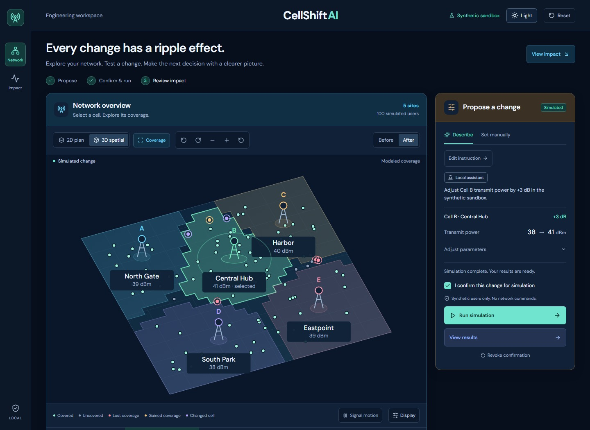
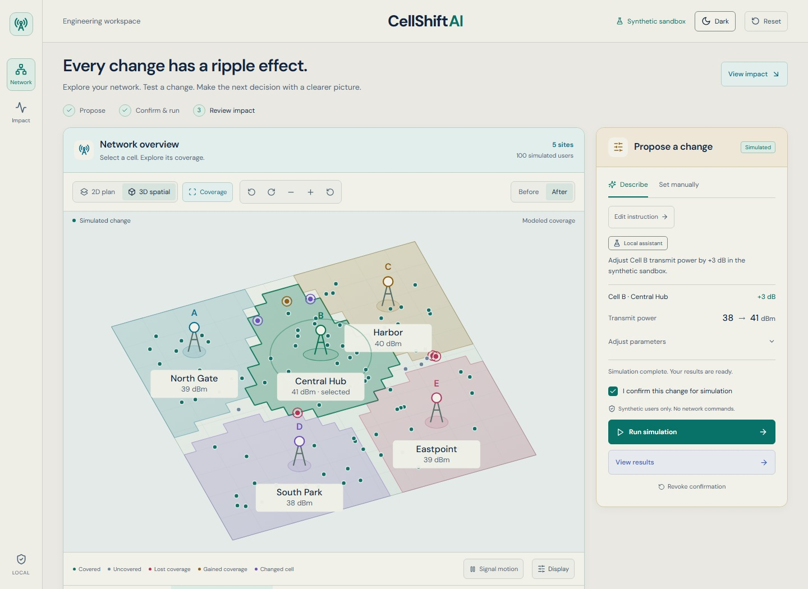
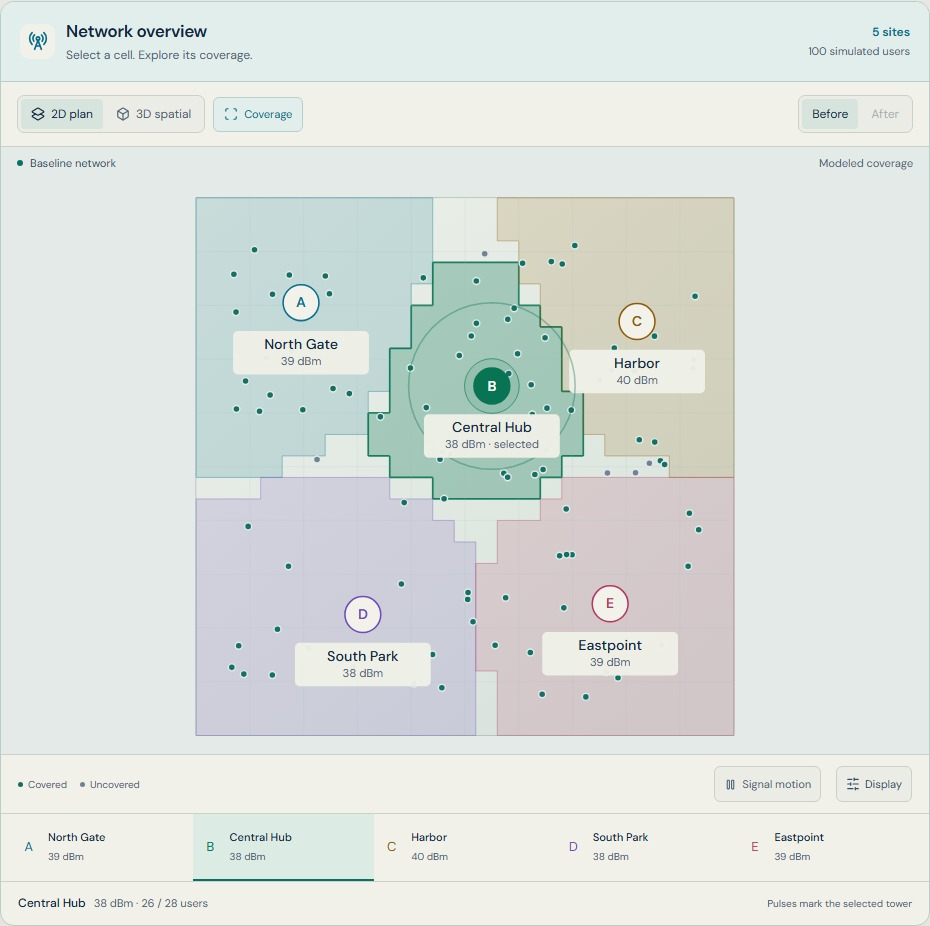
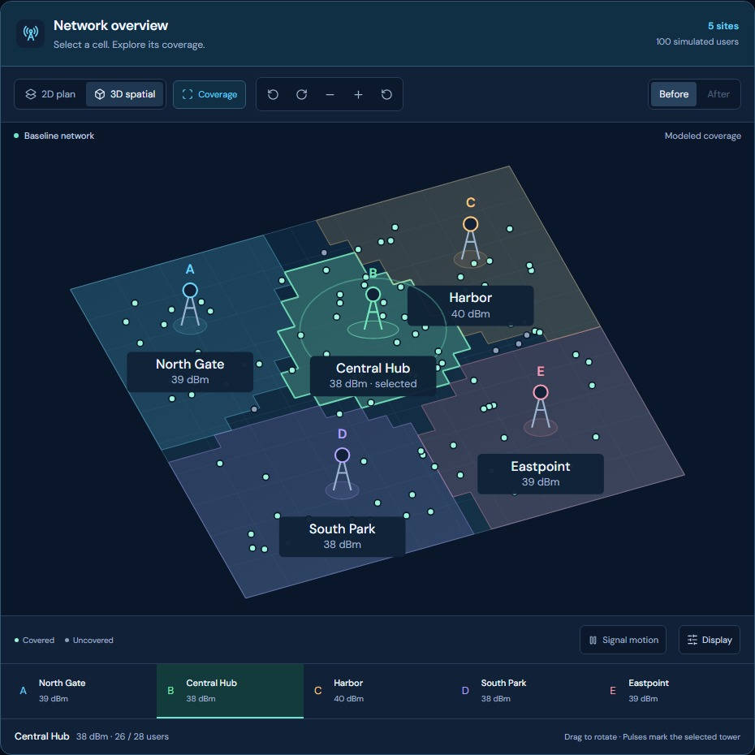
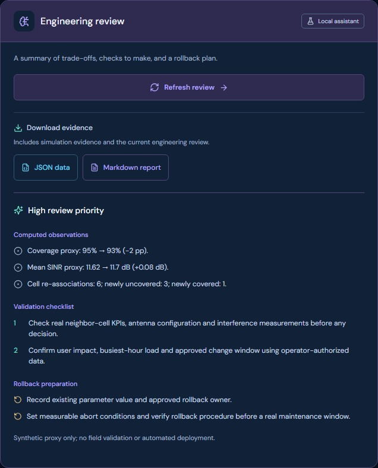
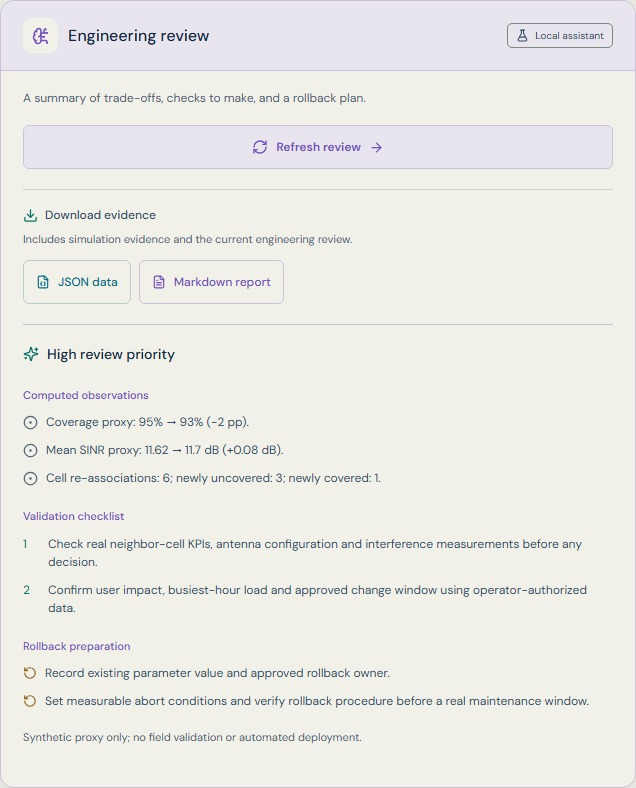
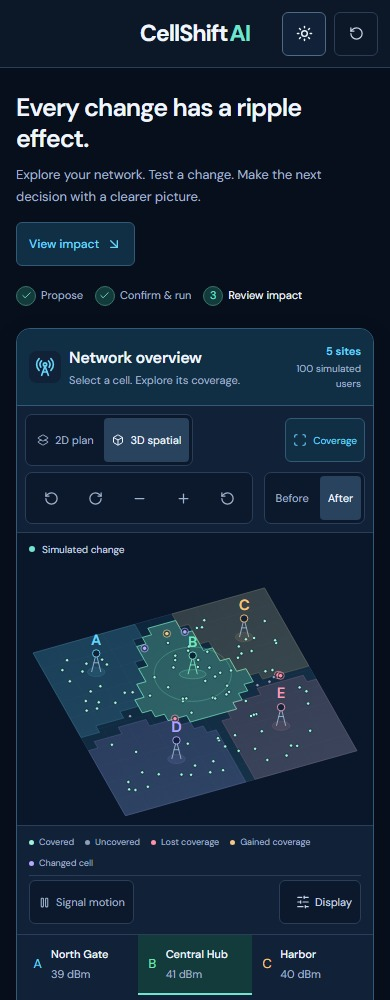

# Workspace gallery

These are screenshots of the running application, not mockups. They use the built-in synthetic scenario. The completed example raises Cell B by 3 dB after explicit confirmation; review text uses the deterministic local fixture.

## Dark workspace

## Light workspace

## The same network in two views

<table>
<tr>
<td width="50%"></td>
<td width="50%"></td>
</tr>
<tr><td>2D: proportional XY plan</td><td>3D: rotatable schematic</td></tr>
</table>

Coverage comes from a separate server-sampled probe grid. It is a synthetic visualization, not a field-validated radio boundary.

## Review and exports

Review actions and exports remain in a stable location above generated prose. Reports retain model limitations and the provenance of AI or local review.

Light-theme review

## Mobile

Mobile preserves the interactive network and stacks the change controls and evidence in reading order.

## Refreshing these images

Start the app, then run `node scripts/capture-docs.mjs`. Set `BASE_URL` if using another port. The capture script intercepts AI routes with local fixtures while using real scenario/simulation endpoints. It saves only screenshots to this folder; it does not include environment files, requests or browser profiles. Inspect new images before committing them.
