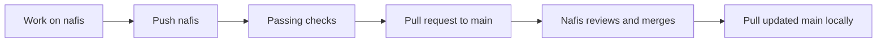

# Repository ownership and workflow

**Repository:** [NafisAfzal/CellShiftAI](https://github.com/NafisAfzal/CellShiftAI)

**Visibility:** private

**Owner and administrator:** NafisAfzal

Only Nafis may change visibility, transfer ownership, manage collaborators or make the final merge into `main`. The current repository is owner-only: Nafis is the sole human writer, and the three pending teammate write invitations have been withdrawn. All five requested branches remain intact.

| Branch | Purpose |
| --- | --- |
| `main` | Shared, reviewed baseline |
| `nafis` | Nafis's work |
| `jabir` | Jabir's work |
| `junaid` | Junaid's work |
| `sami` | Sami's work |

These names are working conventions, not per-person branch permissions. The teammate branches are reserved; teammates do not currently have access. A collaborator's write role would be repository-wide.

## Main protection: current limitation

GitHub returned **HTTP 403: upgrade to GitHub Pro or make this repository public** when enabling rulesets for this private repository. The repository remains private. No billing or visibility change was made.

At the current plan, CODEOWNERS cannot prevent a writer's direct push. Because exclusive control of `main` is required, no other human is granted repository write access. This protects `main` through repository access, while temporarily withholding teammate participation. A local push hook also blocks direct pushes to `main`, but hooks are bypassable and are not the remote security boundary.

GitHub does not offer read-only collaborator access on a private personal repository. Keeping this single repository private, allowing teammates to push, and restricting `main` requires a supported plan. An owner-only canonical repository plus a separate private team workspace is another possible arrangement, but no second repository or ownership transfer has been created.

Official references: [GitHub ruleset availability](https://docs.github.com/en/repositories/configuring-branches-and-merges-in-your-repository/managing-rulesets/about-rulesets), [personal-repository permissions](https://docs.github.com/en/repositories/managing-your-repositorys-settings-and-features/repository-access-and-collaboration/permission-levels-for-a-personal-account-repository).

## Nafis's workflow



Use `git push origin nafis`, then a pull request with base `main` and head `nafis`. A pull updates a local branch; it does not merge a GitHub pull request. After the owner merge, fetch and pull `main`, switch back to `nafis`, and merge `origin/main` into the working branch. Exact commands are in [CONTRIBUTING.md](../CONTRIBUTING.md). Automatic merging remains disabled.

## Prepared protection

[`.github/main-ruleset.json`](../.github/main-ruleset.json) targets only `main` and requests:

- Restrict updates and deletion to bypass actors.
- Block force pushes and require linear history.
- Require pull requests, one approval, Nafis as code owner, resolved discussions and dismissal of stale approvals.
- Require `Quality`, `Browser workflow`, `Static analysis`, `Secrets`, `Feature workflows (firefox)` and `Feature workflows (webkit)`.
- Allow repository administrators to bypass. In this personal repository, administration belongs to Nafis.

When a supported plan is active, authenticate `gh` as NafisAfzal and run:

```powershell
./scripts/protect-main.ps1
```

The script creates or updates the named ruleset, verifies administrator-only bypass and checks that the update restriction is effective on `main`. It does not change visibility or billing. By default it sends no invitations. After the account supports protection, this explicit option restores the three requested write invitations **only after verification succeeds**:

```powershell
./scripts/protect-main.ps1 -InviteCollaborators
```

Wrong identity, unavailable plan, failed application, unsafe bypass or ineffective rules stop the script before invitations; automated fixtures cover those cases without making real GitHub calls. Also verify the resulting rule in **Settings → Rules → Rulesets** and test it with a non-owner collaborator. Owner bypass is intentional; Nafis should still use passing pull requests.

## Repository settings

Squash merging is enabled; merge commits, rebase merging and auto-merge are disabled. Named working branches are not automatically deleted after merge. Issues are enabled, and documentation lives in the repository rather than a separate wiki.

CI has read-only repository permissions. It receives no provider secrets. The default Actions token cannot approve pull requests. Dependabot proposes dependency and action updates for review.

Before making the repository public, complete [PUBLIC_RELEASE.md](PUBLIC_RELEASE.md). Source publication does not deploy the application or grant an open-source license.
